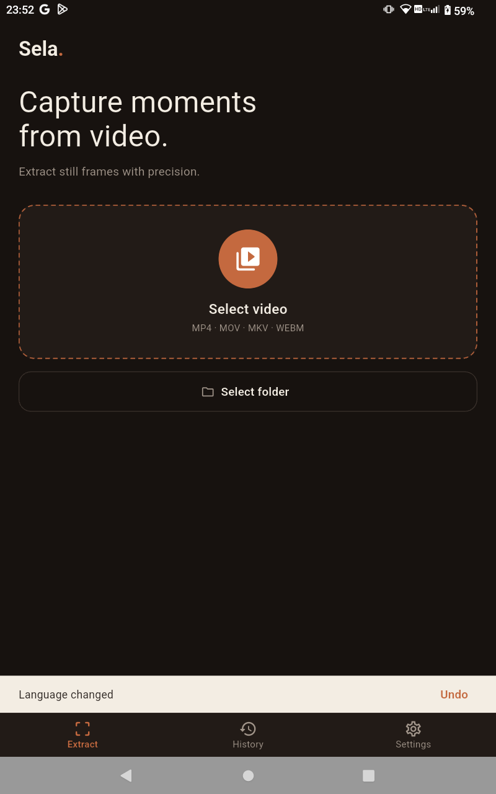
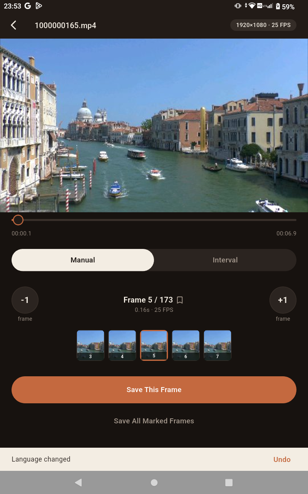
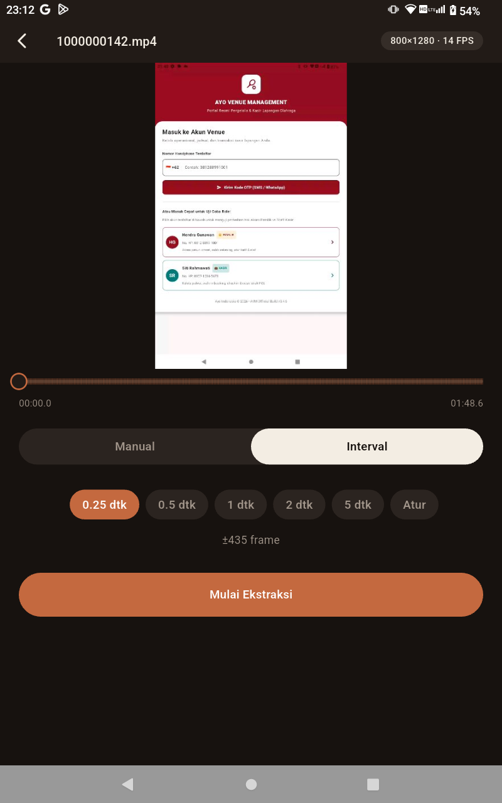
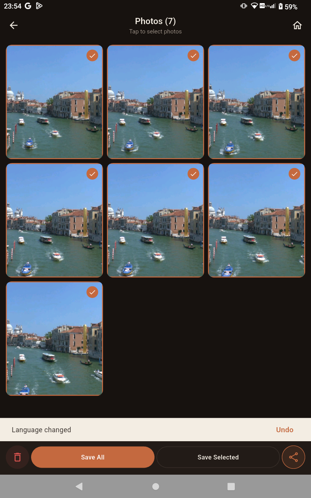
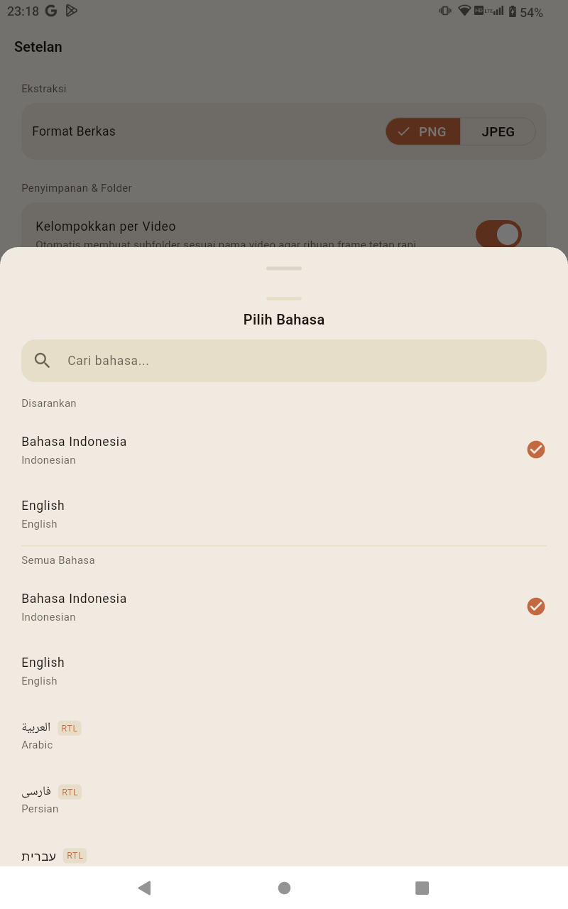
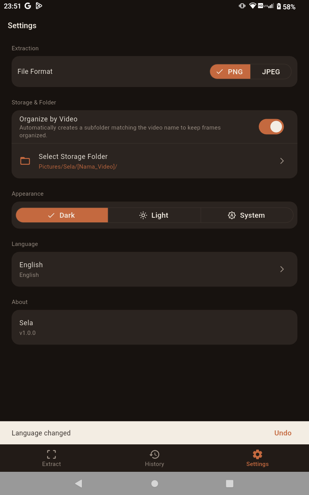

# Sela — Video Frame Extractor for Android

<p align="center">
  <b>An accurate, lightweight video frame extractor for Android.</b><br>
  <i>Built with Flutter and native Android Media APIs (Kotlin).</i>
</p>

<p align="center">
  
  
  
  
  
  
</p>

---

## 🌟 Overview

**Sela** is an open-source Android application designed to extract high-quality still frames from video files with precise frame-level control.

While standard mobile video players prioritize smooth continuous playback, extracting a specific frame often leads to timestamp mismatches or excessive memory usage on mobile hardware. Desktop video editors and command-line tools like FFmpeg can handle this accurately, but transferring files back and forth to a computer is inconvenient.

Sela solves this directly on Android by pairing a clean Flutter interface with native Android media decoders (`MediaMetadataRetriever` and `MediaExtractor` written in Kotlin). It allows you to inspect video timelines, step through individual frames, bookmark key moments, or batch-export frames at fixed time intervals directly on your phone or tablet.

---

## 📱 Application Preview

<p align="center">
  
  
  
</p>
<p align="center">
  
  
  
</p>

---

## ✨ Key Features

- 📸 **Frame-Accurate Stepping**: Navigate through videos frame-by-frame with `-1`, `+1`, `-10`, and `+10` step controls, synchronized with real-time timeline indicators.
- ⏱️ **Interval-Based Batch Extraction**: Extract frames across the entire video or a selected range at preset intervals (0.25s, 0.5s, 1s, 2s, 5s) or custom durations.
- 🎞️ **Responsive Filmstrip Timeline**: Preview video segments with an adaptive thumbnail filmstrip, backed by asynchronous prefetching and a bounded memory cache.
- 🔒 **Privacy-Friendly Photo Picker**: Uses Android's native system photo picker (`MediaStore.ACTION_PICK_IMAGES` on Android 13+) and Storage Access Framework, requiring zero broad storage permissions.
- 🌍 **10-Language Support & Full RTL**: Localized into English, Indonesian, Spanish, French, German, and Japanese, with complete Right-to-Left (RTL) mirroring for Arabic, Persian, Hebrew, and Urdu.
- 💾 **Flexible Frame Export**: Save extracted frames in lossless PNG or compressed JPEG formats directly to your device gallery, with batch selection and sharing support.
- 🎨 **Clean, Distraction-Free Interface**: Thoughtfully designed dark and light themes, readable typography, and subtle tactile haptics.

---

## 📋 Technical Specifications

| Attribute | Specification |
|---|---|
| **Target Platform** | Android (Phones & Tablets) |
| **Supported OS** | Android 10 to Android 15+ (API 29 – 36) |
| **UI Framework** | Flutter 3.47+ (Dart 3.13+) |
| **Native Engine** | Kotlin 2.0+ (Android Media APIs) |
| **State Management** | Riverpod |
| **Input Formats** | MP4, MOV, MKV, WEBM |
| **Export Formats** | PNG (Lossless), JPEG (Configurable quality) |
| **Storage Permissions** | None required (Uses system Photo Picker & SAF) |

---

## 🛠️ Architecture & Engineering Highlights

```
lib/
├── core/             # Cross-cutting utilities & name registries
├── domain/           # Pure Dart business models & time-to-frame math (Zero Flutter dependencies)
├── engine/           # Platform Channel abstractions & native video picker interfaces
├── features/         # Feature-first modular presentation & Riverpod controllers
│   ├── capture/      # Filmstrip, timeline scrubber, preview & thumbnail caching
│   ├── history/      # Resumable sessions & recent extractions repository
│   ├── home/         # Primary navigation shell & video import dropzone
│   ├── progress/     # Live extraction progress indicator & cancellation controller
│   ├── results/      # Frame review grid, multi-selection, batch sharing & deletion
│   └── settings/     # Output format, storage directories, theme & language pickers
├── l10n/             # ARB localization definitions (10 languages)
└── theme/            # Design tokens: SelaColors, SelaSpace, SelaText, SelaTheme
```

### 1. Dedicated Native Executors
Preview timeline scrubbing and filmstrip thumbnail rendering run on separate native thread pools (`previewExecutor` vs. `thumbExecutor`). Rapid scrubbing requests issue sequence tokens that discard superseded decode tasks, keeping the UI smooth and responsive.

### 2. Synchronized Frame & Timestamp Calculations
Container durations and frame rates are extracted via `MediaExtractor` and `MediaMetadataRetriever`. The unified mapping logic ensures predictable synchronization between frame indices and target timestamps across variable-framerate clips.

### 3. Bounded Memory Consumption
To prevent high memory pressure when working with large videos, thumbnail decoding uses strict dimension constraints (`cacheWidth`), and Flutter's in-memory image cache is capped and cleared between sessions.

---

## 🚀 Getting Started

### Prerequisites
- [Flutter SDK](https://flutter.dev) (v3.24+ / v3.47+ recommended)
- [Android SDK](https://developer.android.com/studio) (API 29 to 36)
- Java 17+

### Installation & Run
```bash
# 1. Clone the repository
git clone https://github.com/aozora-b/Sela.git
cd Sela

# 2. Install dependencies
flutter pub get

# 3. Run unit & widget test suite (91 tests)
flutter test

# 4. Launch on connected Android device or emulator
flutter run
```

### Production Build
```bash
# Build split-per-ABI release APKs (~19 MB per architecture):
flutter build apk --split-per-abi --release

# Build Google Play release App Bundle:
flutter build appbundle --release
```

---

## 🧪 Quality Assurance

- **Static Analysis**: `flutter analyze` $\rightarrow$ **0 issues found** (Clean).
- **Test Coverage**: 91 unit & widget tests passing (100% pass rate).
- **Standards**: Modular architecture, zero-noise self-documenting code, and compact file boundaries ($\le 200$ lines per file).

---

## 📄 License

Copyright © 2026 **aozora-b**. Licensed under the [MIT License](LICENSE).
